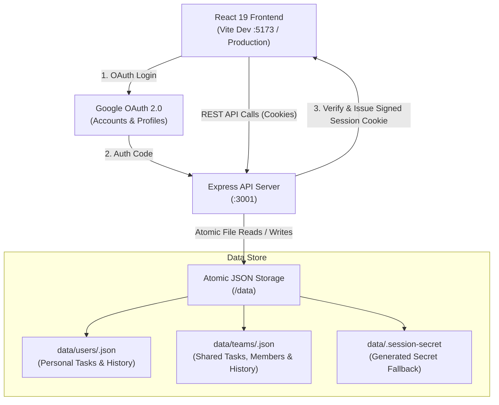

<div align="center">

# 📋 My Tasks

### Collaborative, Multi-User Task & Workspace Management Platform

A modern, full-stack task management application featuring Google OAuth authentication, isolated personal workspaces, real-time shared team boards, interactive progress tracking, and robust file-based persistence.

[](https://react.dev/)
[](https://www.typescriptlang.org/)
[](https://vitejs.dev/)
[](https://expressjs.com/)
[](https://nodejs.org/)

</div>

---

## 📑 Table of Contents

- [Overview](#-overview)
- [Key Features](#-key-features)
- [Tech Stack](#-tech-stack)
- [System Architecture](#-system-architecture)
- [Project Structure](#-project-structure)
- [Getting Started](#-getting-started)
  - [1. Prerequisites](#1-prerequisites)
  - [2. Google OAuth Configuration](#2-google-oauth-configuration)
  - [3. Environment Setup](#3-environment-setup)
  - [4. Installation & Local Development](#4-installation--local-development)
- [Application Usage](#-application-usage)
  - [Personal Workspace](#personal-workspace)
  - [Team Workspaces & Collaboration](#team-workspaces--collaboration)
  - [Task Lifecycle & Progress Updates](#task-lifecycle--progress-updates)
- [Data Storage & Persistence](#-data-storage--persistence)
- [REST API Reference](#-rest-api-reference)
- [Available Scripts](#-available-scripts)
- [Production Deployment](#-production-deployment)

---

## 🌟 Overview

**My Tasks** bridges the gap between private to-do lists and team collaboration boards. Users authenticate securely via their Google accounts, immediately accessing an isolated personal workspace. From there, users can create teams, invite colleagues via Google email, delegate tasks with clear deadlines, and post incremental progress updates with visual sliders.

All application state is persisted with atomic file operations on the backend, removing the overhead of complex external database installations while ensuring zero data corruption across restarts.

---

## ✨ Key Features

### 🔐 Secure Authentication & Personal Privacy
- **Google OAuth 2.0 Integration**: Single sign-on with verified Google accounts; no separate passwords required.
- **Signed Session Cookies**: Tamper-proof, `HttpOnly` signed session management.
- **Isolated Personal Space**: Personal tasks and history are strictly private to each Google account.

### 👥 Team Collaboration Workspaces
- **Team Creation & Email Invitations**: Create teams and invite members directly by their Google email address.
- **Instant Workspace Sync**: Invited users see their team workspaces automatically upon sign-in.
- **Task Delegation & Assignment**: Assign tasks to specific team members with full visibility.
- **Role-Based Permissions**: Team owners manage team settings and membership; members collaborate on tasks and updates.
- **Live Background Refresh**: Automatically synchronizes team tasks every 20 seconds and whenever the browser tab regains focus.

### 🎯 Task Lifecycle & Fine-Grained Progress Tracking
- **Smart Deadlines**: Add tasks with optional date and time deadlines.
- **Status Indicators**: Dynamic highlighting for upcoming, due-today, and overdue deadlines.
- **Interactive Progress Slider (0–100%)**: Log progress snapshots with accompanying status notes.
- **Comprehensive History & Audit Log**: Completed tasks capture creation time, completion time, final progress, and a chronological history of all updates.
- **Multi-State Filtering**: Quick filter views for **All**, **Pending** (active & on-time), **Overdue**, and **Completed**.

---

## 🛠 Tech Stack

| Layer | Technologies |
| :--- | :--- |
| **Frontend** | React 19, TypeScript, Modern CSS (CSS Variables, Flexbox/Grid), Vite |
| **Backend** | Express 4, Node.js (v20+), `tsx` (TypeScript runtime) |
| **Authentication** | Google OAuth 2.0 (Authorization Code Flow), Cryptographic HMAC Signatures |
| **Storage Engine** | Local File System (JSON) with Atomic Write Guarantees |
| **Dev Tooling** | Concurrently, Vite Dev Server with API Proxying |

---

## 🏗 System Architecture



---

## 📁 Project Structure

```text
todo-app/
├── data/                      # File-based database (git-ignored)
│   ├── teams/                 # Team JSON files (<team-id>.json)
│   ├── users/                 # User personal files (<hash>.json)
│   └── .session-secret        # Auto-generated session secret (if not set in env)
├── server/
│   └── index.ts               # Express server, OAuth, session logic, and API endpoints
├── src/
│   ├── components/            # React UI components
│   │   ├── FilterTabs.tsx     # Filter selector (All / Pending / Overdue / Completed)
│   │   ├── HistoryItem.tsx    # Completed task card & update log viewer
│   │   ├── HistoryList.tsx    # List container for completed tasks
│   │   ├── icons.tsx          # SVG icon collection
│   │   ├── LoginScreen.tsx    # Authentication landing page
│   │   ├── MembersPanel.tsx   # Team member management & invitations
│   │   ├── PersonalView.tsx   # Personal task list & history view
│   │   ├── Sidebar.tsx        # Navigation sidebar (Personal vs Teams)
│   │   ├── TaskForm.tsx       # Personal task input form
│   │   ├── TaskItem.tsx       # Active task item with progress bar & update controls
│   │   ├── TaskList.tsx       # Active tasks container
│   │   ├── TeamTaskForm.tsx   # Shared team task creation form
│   │   └── TeamView.tsx       # Shared team task board & member tabs
│   ├── api.ts                 # Typed client API wrapper
│   ├── App.tsx                # Main app layout, state routing & polling
│   ├── format.ts              # Date, time, and deadline formatting helpers
│   ├── index.css              # Application styling and theme tokens
│   ├── main.tsx               # React application entry point
│   └── types.ts               # Shared TypeScript interfaces
├── .env.example               # Template environment configuration
├── .gitignore                 # Standardized Git exclusions
├── index.html                 # Single page application HTML shell
├── package.json               # Dependencies and runner scripts
├── tsconfig.json              # Client TypeScript configuration
├── tsconfig.server.json       # Server TypeScript configuration
└── vite.config.ts             # Vite configuration with proxy rules
```

---

## 🚀 Getting Started

### 1. Prerequisites

- **Node.js**: `v20.0.0` or higher recommended
- **npm**: `v9.0.0` or higher
- A **Google Account** (to configure OAuth credentials)

### 2. Google OAuth Configuration

To enable Google sign-in:

1. Navigate to the [Google Cloud Console](https://console.cloud.google.com/).
2. Create a new project (e.g., `My Tasks App`).
3. Configure the **OAuth consent screen**:
   - User Type: **External**.
   - Fill in App Name, Support Email, and Developer Contact Email.
   - Scopes: Add `openid`, `email`, and `profile`.
   - Save and proceed. While testing, add your Google email under **Test Users**.
4. Create Credentials:
   - Go to **APIs & Services → Credentials → Create Credentials → OAuth client ID**.
   - Application Type: **Web application**.
   - Name: `My Tasks Web Client`.
   - **Authorized redirect URIs**:
     - Development: `http://localhost:5173/api/auth/google/callback`
     - Production: `https://your-domain.com/api/auth/google/callback`
5. Note down the **Client ID** and **Client Secret**.

> [!NOTE]
> In local development with `npm run dev`, Vite runs on port `5173` and proxies `/api` calls to port `3001`. Therefore, the redirect URI points to port `5173`.

### 3. Environment Setup

Copy the sample environment file:

```bash
cp .env.example .env
```

Populate `.env` with your Google OAuth credentials:

```ini
# Google OAuth Credentials
GOOGLE_CLIENT_ID=your-client-id.apps.googleusercontent.com
GOOGLE_CLIENT_SECRET=GOCSPX-your-client-secret

# Optional Configuration
# APP_URL=http://localhost:5173
# SESSION_SECRET=generated-32-byte-hex-string
# PORT=3001
```

#### Environment Variables Matrix

| Variable | Required | Default | Description |
| :--- | :---: | :---: | :--- |
| `GOOGLE_CLIENT_ID` | **Yes** | — | Google Cloud OAuth 2.0 Client ID |
| `GOOGLE_CLIENT_SECRET` | **Yes** | — | Google Cloud OAuth 2.0 Client Secret |
| `APP_URL` | Production | Auto-detected | Canonical app URL (e.g. `https://tasks.example.com`) |
| `SESSION_SECRET` | Production | Auto-generated in `data/` | Secret key used to sign HTTP session cookies |
| `PORT` | No | `3001` | Port on which the Express server listens |
| `OAUTH_REDIRECT_URI` | No | Inferred | Manual override for Google OAuth callback URI |
| `LEGACY_OWNER_EMAIL` | No | — | Email permitted to inherit older single-user `data/tasks.json` |

Generate a production-grade session secret anytime with:
```bash
node -e "console.log(require('crypto').randomBytes(32).toString('hex'))"
```

### 4. Installation & Local Development

Install project dependencies:

```bash
npm install
```

Launch both the backend API and frontend dev server concurrently:

```bash
npm run dev
```

- **Frontend**: [http://localhost:5173](http://localhost:5173)
- **Backend API**: [http://localhost:3001](http://localhost:3001)

Visit `http://localhost:5173` in your browser and click **Continue with Google** to sign in.

---

## 💻 Application Usage

### Personal Workspace
- Click **My Tasks** in the sidebar to open your private board.
- Tasks added here are strictly private to your Google account.
- Type a task description, select an optional deadline date/time, and press Enter or `+`.

### Team Workspaces & Collaboration
- **Create Teams**: Click **New team** in the sidebar, name your team, and click Create.
- **Invite Teammates**: Switch to the **Members** tab in the team view and add teammates by their Google email address.
- **Assign Work**: When creating a shared task, select any team member from the assignee dropdown.
- **Live Sync**: Teams automatically refresh every 20 seconds, or immediately upon switching browser tabs back to the app.

### Task Lifecycle & Progress Updates
- **Progress Tracking**: Click **Add update** on any active task. Drag the slider (0–100%) and enter an optional note.
- **Completion**: Click the checkmark circle. The task completes, updates to 100% progress, and archives into **History**.
- **History Audit**: Switch to the **Completed** tab to review completed tasks, deadlines, on-time delivery status, and every logged comment with its timestamp.

---

## 💾 Data Storage & Persistence

The backend utilizes an atomic, file-based persistence mechanism located in the `data/` directory:

- **Per-User Isolation**: User records are stored at `data/users/<hash>.json`, where `<hash>` is the SHA-256 hash of the Google account ID (`sub`), safeguarding privacy.
- **Shared Team Files**: Teams are saved under `data/teams/<team-id>.json`.
- **Atomic Writes**: Writes first go to a temporary file (`.tmp`) and are renamed atomically (`fs.rename`), preventing file corruption during power interruptions or process restarts.
- **Automatic Diagnostics**: If a file ever fails to parse, it is backed up as `<file>.corrupt-<timestamp>` rather than discarded.

---

## 🔌 REST API Reference

All task and team endpoints require an active, authenticated session. Unauthenticated requests return `401 Unauthorized`.

### Authentication
| Method | Endpoint | Description |
| :--- | :--- | :--- |
| `GET` | `/api/auth/me` | Fetch current session info and Google configuration status |
| `GET` | `/api/auth/google` | Initiate Google OAuth 2.0 redirection |
| `GET` | `/api/auth/google/callback` | OAuth callback handler |
| `POST` | `/api/auth/logout` | Terminate session and clear cookies |

### Personal Workspace
| Method | Endpoint | Description |
| :--- | :--- | :--- |
| `GET` | `/api/state` | Retrieve active tasks and completed history |
| `POST` | `/api/tasks` | Create a personal task (`{ text, dueAt }`) |
| `POST` | `/api/tasks/:id/complete` | Mark personal task as completed |
| `POST` | `/api/tasks/:id/comments` | Post a progress update (`{ text, progress }`) |
| `DELETE` | `/api/tasks/:id/comments/:commentId` | Remove a progress update |
| `DELETE` | `/api/tasks/:id` | Delete an active personal task |
| `DELETE` | `/api/history` | Clear personal completed task history |

### Teams & Shared Tasks
| Method | Endpoint | Description |
| :--- | :--- | :--- |
| `GET` | `/api/teams` | List teams where current user is a member |
| `POST` | `/api/teams` | Create a new team (`{ name }`) |
| `GET` | `/api/teams/:id` | Fetch full team details, members, tasks, and history |
| `DELETE` | `/api/teams/:id` | Delete a team (*Owner only*) |
| `POST` | `/api/teams/:id/members` | Invite a teammate (`{ email }`) |
| `DELETE` | `/api/teams/:id/members/:email` | Remove member or leave team |
| `POST` | `/api/teams/:id/tasks` | Add shared task (`{ text, dueAt, assigneeEmail }`) |
| `POST` | `/api/teams/:id/tasks/:taskId/complete` | Complete a shared task |
| `POST` | `/api/teams/:id/tasks/:taskId/comments` | Post an update to a team task |
| `DELETE` | `/api/teams/:id/tasks/:taskId/comments/:id` | Remove a team task update |
| `DELETE` | `/api/teams/:id/tasks/:taskId` | Delete a shared task |
| `DELETE` | `/api/teams/:id/history` | Clear team history (*Owner only*) |

---

## 📜 Available Scripts

| Command | Action |
| :--- | :--- |
| `npm run dev` | Runs both backend API and Vite dev server concurrently |
| `npm run dev:web` | Runs the Vite client development server only |
| `npm run dev:server` | Runs the Express API server with watch mode (`tsx`) |
| `npm run build` | Performs TypeScript typechecking and builds client assets into `dist/` |
| `npm start` | Launches the production Express server serving the API and built assets |
| `npm run typecheck` | Typechecks both frontend (`tsconfig.json`) and backend (`tsconfig.server.json`) |
| `npm run preview` | Locally previews the built production Vite client |

---

## 🌐 Production Deployment

1. **Build the Application**:
   ```bash
   npm run build
   ```
2. **Configure Host Environment Variables**:
   ```ini
   NODE_ENV=production
   PORT=3001
   APP_URL=https://tasks.yourdomain.com
   SESSION_SECRET=your-random-32-byte-hex-string
   GOOGLE_CLIENT_ID=your-client-id.apps.googleusercontent.com
   GOOGLE_CLIENT_SECRET=your-client-secret
   ```
3. **Start the Production Server**:
   ```bash
   npm start
   ```
4. **HTTPS Requirement**:
   In production (`NODE_ENV=production`), session cookies enforce `Secure: true`. Ensure your app is served over HTTPS via a reverse proxy such as Nginx, Caddy, Cloudflare, or AWS ALB.
5. **Google Cloud Callback**:
   Ensure `https://tasks.yourdomain.com/api/auth/google/callback` is listed under **Authorized redirect URIs** in your Google Cloud Console.
