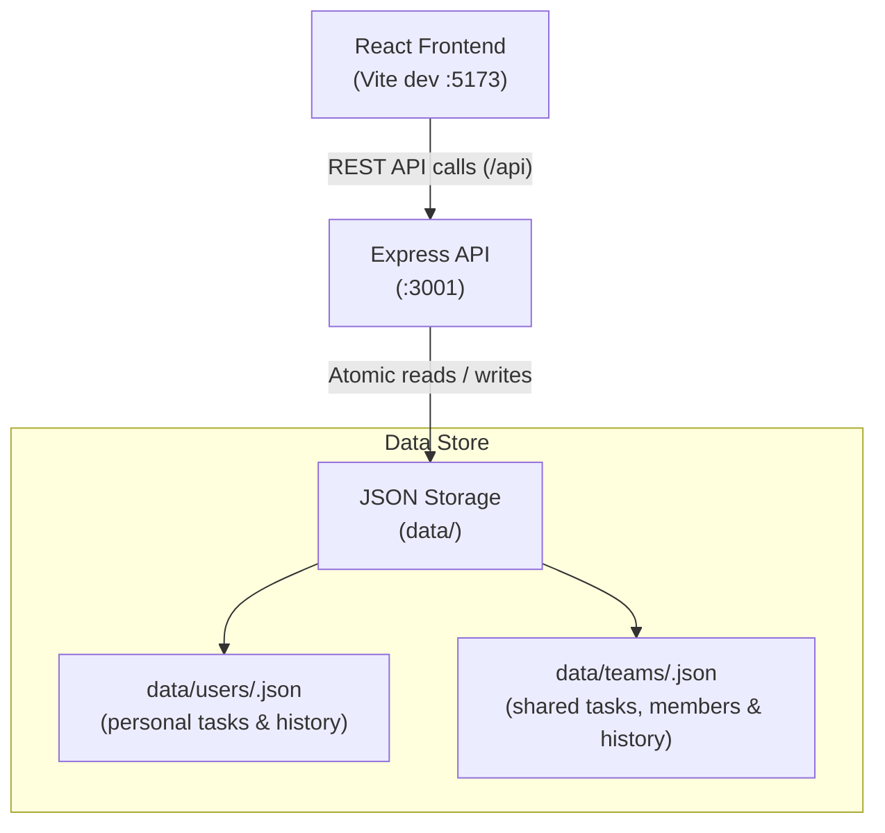

<div align="center">

# 📋 My Tasks

### Collaborative task management with private lists and shared team boards

A full-stack task manager built with React, TypeScript, and Express. It pairs a
private personal to-do list with shared team workspaces, deadlines, progress
updates, and a complete completion history — all persisted to plain JSON files
on the server.

[](https://react.dev/)
[](https://www.typescriptlang.org/)
[](https://vitejs.dev/)
[](https://expressjs.com/)
[](https://nodejs.org/)

</div>

---

> [!IMPORTANT]
> **Local mode — no sign-in.** Sign-in has been intentionally removed for now.
> The app runs as a single local profile and is fully usable offline. A new
> account system will replace this mode in a later change.

---

## 📑 Table of Contents

- [Overview](#-overview)
- [Key Features](#-key-features)
- [Tech Stack](#-tech-stack)
- [How It Works](#-how-it-works)
- [Project Structure](#-project-structure)
- [Getting Started](#-getting-started)
- [Using the App](#-using-the-app)
- [Data Storage](#-data-storage)
- [REST API Reference](#-rest-api-reference)
- [Available Scripts](#-available-scripts)
- [Building for Production](#-building-for-production)

---

## 🌟 Overview

**My Tasks** keeps personal planning and team collaboration in one place:

- A **personal workspace** for private tasks, deadlines, progress, and history.
- **Team workspaces** where members share tasks, assign work, and post updates.
- **Live refresh** so open team boards pick up changes without a reload.
- **File-based persistence** with atomic writes, so data survives restarts.

The current build runs without authentication, using one local profile. Personal
tasks are stored for that profile, and teams are stored separately so they can
be shared again once accounts are added.

---

## ✨ Key Features

### 📝 Personal Workspace
- Private task list with optional date and time deadlines.
- Dynamic deadline states: upcoming, due today, and overdue.
- Progress slider (0–100%) with optional notes on every update.
- Filters for **All**, **Pending**, **Overdue**, and **Completed**.
- Completed tasks move into a full history with completion timestamps and all
  logged updates.

### 👥 Team Collaboration
- Create teams and invite members by email address.
- Assign shared tasks to specific team members.
- Role-based permissions: owners manage membership and team settings, while
  members collaborate on tasks and updates.
- Every shared task and update shows its author and assignee.
- Team boards and the sidebar refresh every 20 seconds and when the tab regains
  focus.

### 🛡 Reliable Storage
- Plain JSON files in `data/` — no database server required.
- Atomic writes via temporary files and `fs.rename`.
- Corrupt files are backed up instead of discarded.
- Personal and team data are stored separately.

---

## 🛠 Tech Stack

| Layer | Technologies |
| :--- | :--- |
| **Frontend** | React 19, TypeScript, Vite 8, modern CSS |
| **Backend** | Express 4, Node.js 20+, `tsx` |
| **Storage** | Local JSON files with atomic writes |
| **Tooling** | Concurrently, TypeScript project references |

---

## 🏗 How It Works



In development, Vite proxies `/api` requests to the Express server. In
production, Express serves both the built frontend and the API.

---

## 📁 Project Structure

```text
todo-app/
├── data/                       # File-based storage (git-ignored)
│   ├── users/                  # Personal task files (<hash>.json)
│   └── teams/                  # Team files (<team-id>.json)
├── server/
│   └── index.ts                # Express API, storage, and validation
├── src/
│   ├── components/             # React UI components
│   │   ├── FilterTabs.tsx
│   │   ├── HistoryItem.tsx
│   │   ├── HistoryList.tsx
│   │   ├── MembersPanel.tsx
│   │   ├── PersonalView.tsx
│   │   ├── Sidebar.tsx
│   │   ├── TaskForm.tsx
│   │   ├── TaskItem.tsx
│   │   ├── TaskList.tsx
│   │   ├── TeamTaskForm.tsx
│   │   ├── TeamView.tsx
│   │   └── icons.tsx
│   ├── api.ts                  # Typed client API wrapper
│   ├── App.tsx                 # App layout, routing, and polling
│   ├── format.ts               # Date and deadline helpers
│   ├── index.css               # Theme tokens and styles
│   ├── main.tsx                # React entry point
│   └── types.ts                # Shared TypeScript types
├── .env.example                # Environment template
├── .gitignore
├── index.html
├── package.json
├── tsconfig.json
├── tsconfig.server.json
└── vite.config.ts
```

---

## 🚀 Getting Started

### Prerequisites

- **Node.js** 20 or newer
- **npm** 9 or newer

### 1. Install dependencies

```bash
npm install
```

### 2. Configure the local profile

Copy the example environment file:

```bash
cp .env.example .env
```

`.env` controls the temporary local profile:

```ini
LOCAL_USER_SUB=local-user
LOCAL_USER_EMAIL=local@localhost
LOCAL_USER_NAME=Local User

# Optional
# PORT=3001
```

| Variable | Required | Default | Description |
| :--- | :---: | :--- | :--- |
| `LOCAL_USER_SUB` | No | `local-user` | Stable ID for the local profile and its data file |
| `LOCAL_USER_EMAIL` | No | `local@localhost` | Display email for the local profile |
| `LOCAL_USER_NAME` | No | `Local User` | Display name for the local profile |
| `PORT` | No | `3001` | API server port |

To keep existing local tasks, set `LOCAL_USER_SUB` to the ID used previously.
The migration to the new storage naming is handled automatically the first time
the server starts.

### 3. Run locally

```bash
npm run dev
```

- **App:** [http://localhost:5173](http://localhost:5173)
- **API:** [http://localhost:3001](http://localhost:3001)

Open the app in your browser — no sign-in is required.

---

## 💻 Using the App

### Personal tasks
1. Open **My Tasks** in the sidebar.
2. Type a task and optionally choose a deadline.
3. Press **Enter** or click **+** to add it.
4. Use the filter tabs to focus on pending, overdue, or completed work.

### Progress and history
- Click **Add update** on a task, drag the progress slider, and add an optional
  note.
- Click the checkmark to complete a task. It moves to **Completed** with a
  timestamp and its full update log.

### Teams
1. Click **New team**, enter a name, and create it.
2. Open the **Members** tab and invite people by email.
3. Add shared tasks and assign them to a teammate.
4. Team owners can remove members or delete the team; members can leave.

---

## 💾 Data Storage

Everything is stored under `data/` on the server:

- **Personal data:** `data/users/<hash>.json`, where `<hash>` is derived from
  the profile ID (`sub`). This keeps personal tasks and history separate.
- **Teams:** `data/teams/<team-id>.json`, including members, tasks, comments,
  and history.
- **Atomic writes:** updates are written to a temporary file and renamed into
  place, avoiding partial writes.
- **Recovery:** unreadable files are backed up as `<file>.corrupt-<timestamp>`
  rather than deleted.

`data/` is intentionally excluded from Git so personal content is never
committed.

---

## 🔌 REST API Reference

The API runs without authentication in local mode. All endpoints are served
under `/api`.

### Profile
| Method | Endpoint | Description |
| :--- | :--- | :--- |
| `GET` | `/api/me` | Return the current local profile |

### Personal Workspace
| Method | Endpoint | Description |
| :--- | :--- | :--- |
| `GET` | `/api/state` | Get active tasks and completed history |
| `POST` | `/api/tasks` | Create a task (`{ text, dueAt }`) |
| `POST` | `/api/tasks/:id/complete` | Complete a task |
| `POST` | `/api/tasks/:id/comments` | Add an update (`{ text, progress }`) |
| `DELETE` | `/api/tasks/:id/comments/:commentId` | Delete an update |
| `DELETE` | `/api/tasks/:id` | Delete an active task |
| `DELETE` | `/api/history` | Clear completed history |

### Teams & Shared Tasks
| Method | Endpoint | Description |
| :--- | :--- | :--- |
| `GET` | `/api/teams` | List teams for the current profile |
| `POST` | `/api/teams` | Create a team (`{ name }`) |
| `GET` | `/api/teams/:id` | Get a team with members, tasks, and history |
| `DELETE` | `/api/teams/:id` | Delete a team (owner only) |
| `POST` | `/api/teams/:id/members` | Invite a member (`{ email }`) |
| `DELETE` | `/api/teams/:id/members/:email` | Remove a member or leave |
| `POST` | `/api/teams/:id/tasks` | Add a shared task (`{ text, dueAt, assigneeEmail }`) |
| `POST` | `/api/teams/:id/tasks/:taskId/complete` | Complete a shared task |
| `POST` | `/api/teams/:id/tasks/:taskId/comments` | Add an update to a shared task |
| `DELETE` | `/api/teams/:id/tasks/:taskId/comments/:id` | Delete a shared task update |
| `DELETE` | `/api/teams/:id/tasks/:taskId` | Delete a shared task |
| `DELETE` | `/api/teams/:id/history` | Clear team history (owner only) |

---

## 📜 Available Scripts

| Command | Action |
| :--- | :--- |
| `npm run dev` | Run the API and Vite dev server together |
| `npm run dev:web` | Run the Vite client only |
| `npm run dev:server` | Run the API with watch mode |
| `npm run build` | Typecheck and build the client into `dist/` |
| `npm start` | Serve the API and built client from Express |
| `npm run typecheck` | Typecheck the client and server projects |
| `npm run preview` | Preview the production Vite build locally |

---

## 🌐 Building for Production

1. Build the app:

   ```bash
   npm run build
   ```

2. Start the server:

   ```bash
   npm start
   ```

3. Set the port if needed:

   ```ini
   PORT=3001
   ```

Express serves the built files from `dist/` and exposes the same `/api` routes.
Because local mode has no credentials or sessions, no extra secrets are required.
